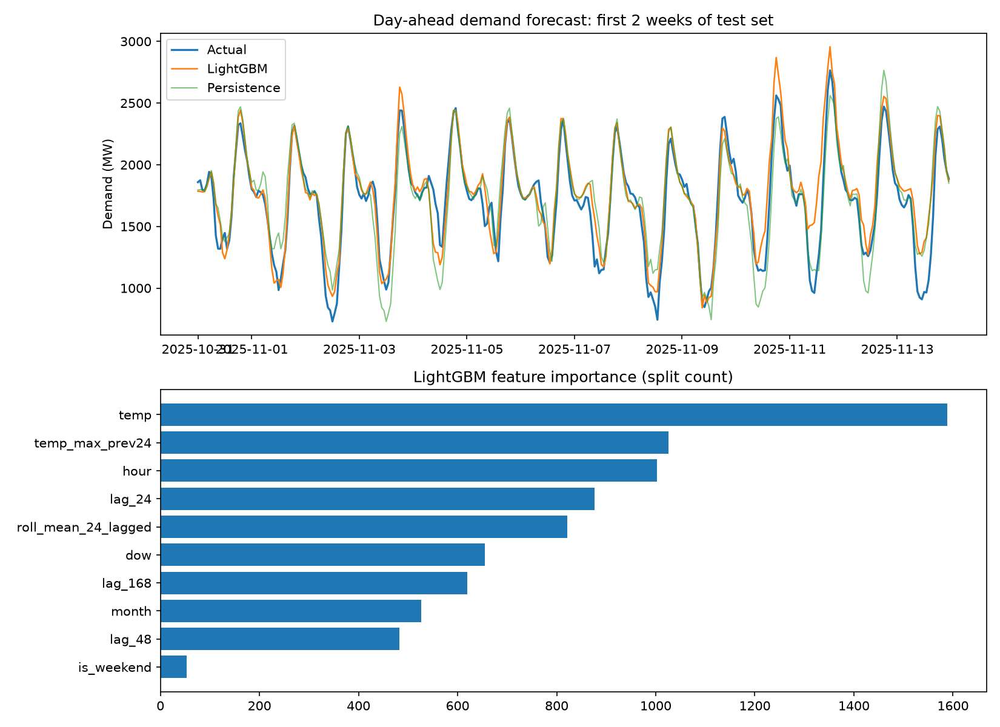

# WA Day-Ahead Electricity Demand Forecasting

A day-ahead (24-hour) demand forecasting model for Western Australia's South West Interconnected System (SWIS), built with Python and LightGBM. It is evaluated against simple baselines on a 12-month chronological hold-out period.



## Result

| Model | MAE (MW) | RMSE (MW) | MAPE |
|---|---|---|---|
| Persistence (same hour yesterday) | 192.28 | 271.32 | 9.38% |
| Seasonal naive (same hour last week) | 283.58 | 404.10 | 13.58% |
| **LightGBM** | **139.51** | **199.02** | **6.74%** |

LightGBM reduces MAE by **27.4%** versus the best baseline (same hour yesterday) on a 12-month held-out test period. RMSE falls by 26.6%.

## Problem

Given what is known 24 hours before a given hour, predict the grid's operational demand (MW) for that hour. Day-ahead forecasts support planning of generation and reserves.

## Data

| Source | Details |
|---|---|
| AEMO Market Data Western Australia (post-reform) | Operational Demand, 5-minute dispatch intervals, 1 Jan 2024 to 6 Nov 2026 (about 300,000 rows), aggregated to hourly means |
| Open-Meteo Historical Weather API | Hourly `temperature_2m` for Perth (-31.95, 115.86), timezone Australia/Perth |

The raw CSVs are not included in this repository. Download the `OperationalDemandWithdrawal` files from AEMO's WA market data site and check AEMO's terms of use before redistributing any data.

## Method

**Features**
- Calendar: hour, day of week, month, weekend flag
- Temperature at the target hour, and the maximum temperature over the 24 hours ending 24 hours before the target
- Demand lagged by 24 h, 48 h and 168 h
- Mean demand over the 24 hours ending 24 hours before the target

**Leakage control.** Every demand-derived feature is shifted so it would have been known at forecast time (24 hours before the target). Only calendar fields and temperature at the target hour are "future" inputs.

**Validation.** Strict chronological split: the last 12 months are held out as the test set. Early stopping uses a separate validation slice taken from the end of the training period, so nothing from the test period influences training.

**Model.** `LGBMRegressor` (learning rate 0.03, 31 leaves, row and column subsampling, up to 2,000 trees with early stopping after 100 rounds without improvement).

**Baselines.** Same hour yesterday, and same hour last week.

## Limitations

- **Observed temperature stands in for a weather forecast.** A live system would use forecast temperature, so real day-ahead error would be somewhat higher.
- Single weather location (Perth) for the whole grid.
- No public holiday, cloud cover or solar irradiance features. Operational demand excludes rooftop solar, so midday demand is shaped by weather the model only sees indirectly through temperature and hour.
- A single train/test split, not rolling-origin cross-validation.
- Hyperparameters were not tuned.
- Errors are largest on extreme heat days, where the model tends to overshoot.

## Run it

```bash
pip install lightgbm scikit-learn pandas matplotlib requests
python wa_demand_forecast.py --demand-csv "OperationalDemandWithdrawal-*.csv" --test-months 12
```

Outputs: console results table, `results.csv`, `forecast_chart.png`. Use `--demo` to run the pipeline on synthetic data as a smoke test (the numbers are not meaningful).

## Possible improvements

- Use archived weather forecasts instead of observed temperature
- Add public holidays and solar irradiance or cloud cover
- Rolling-origin cross-validation and hyperparameter tuning
- Prediction intervals (quantile regression) for peak-demand risk
